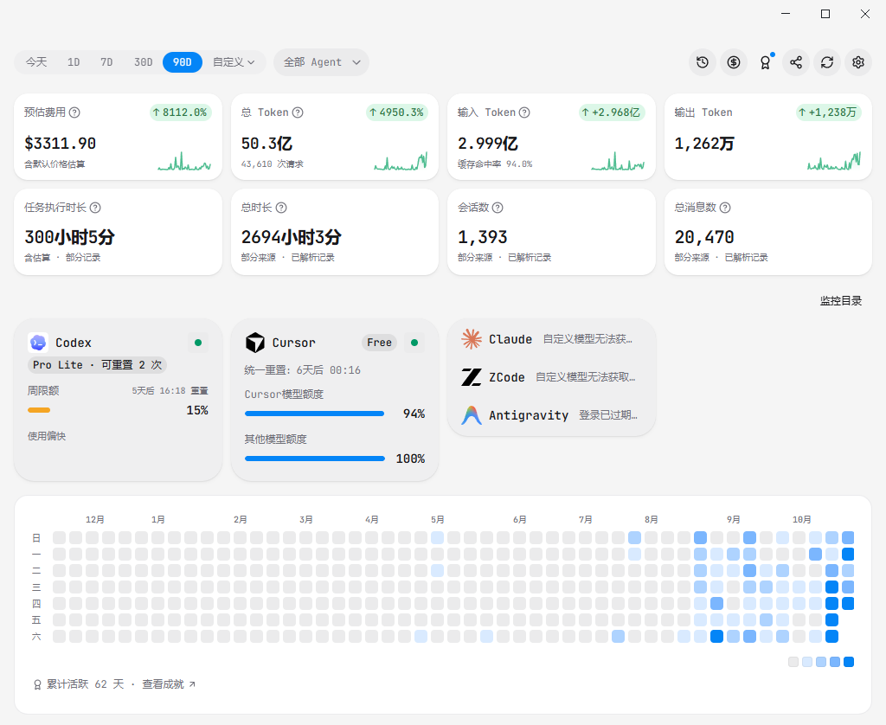
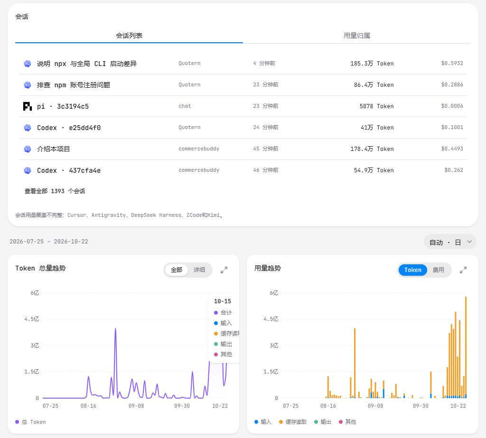
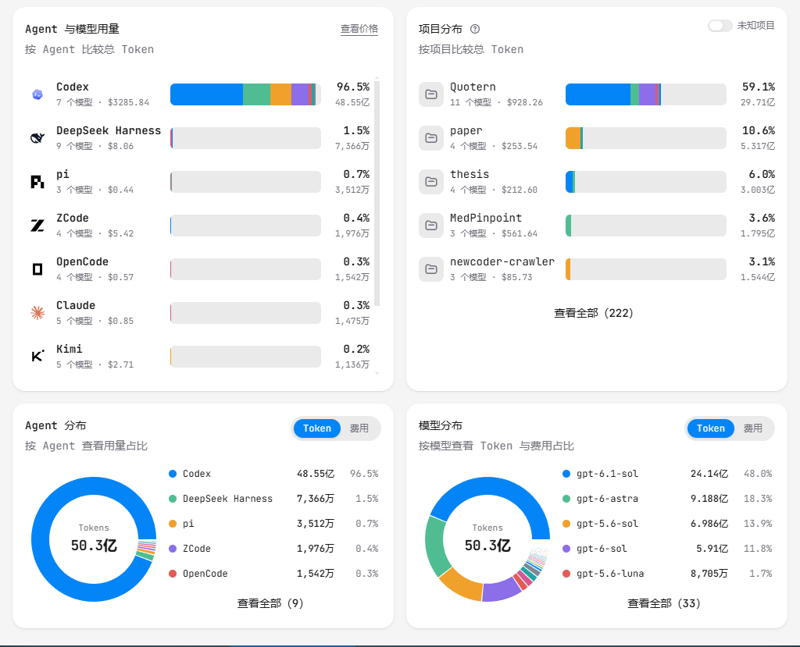
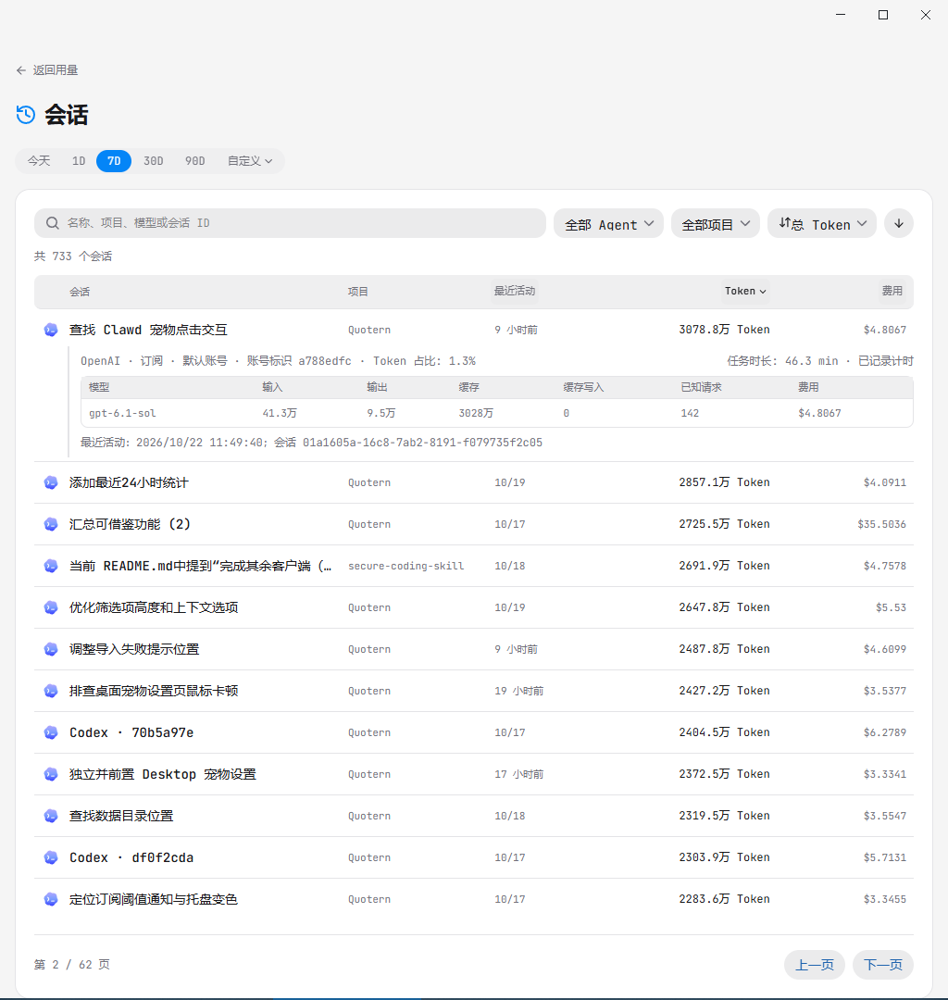
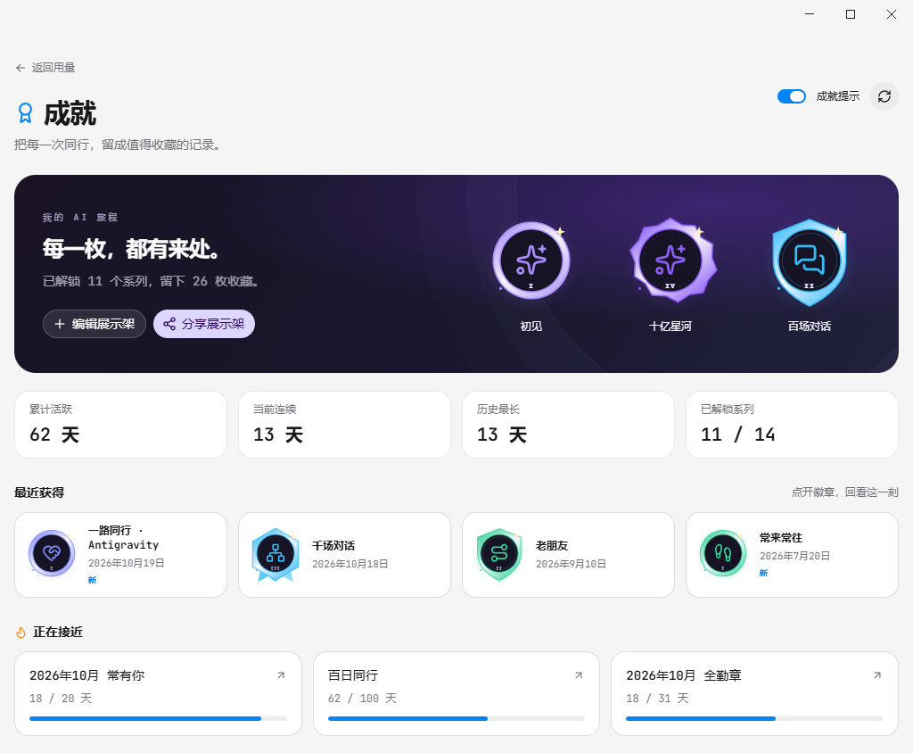
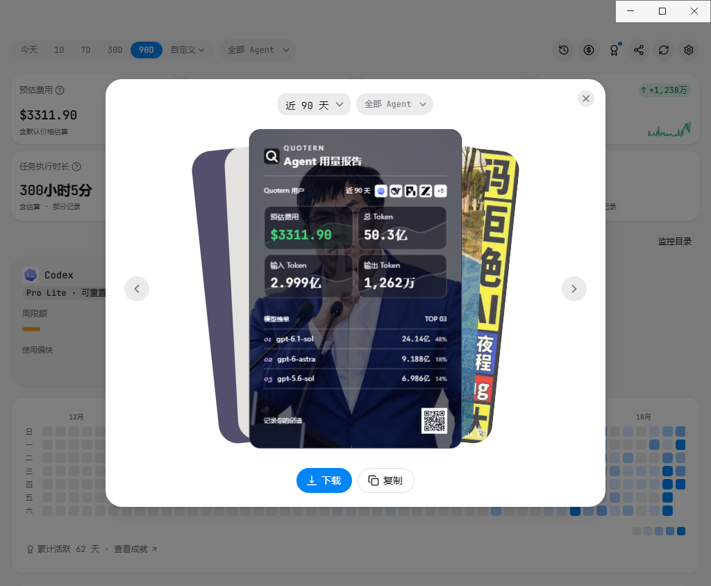
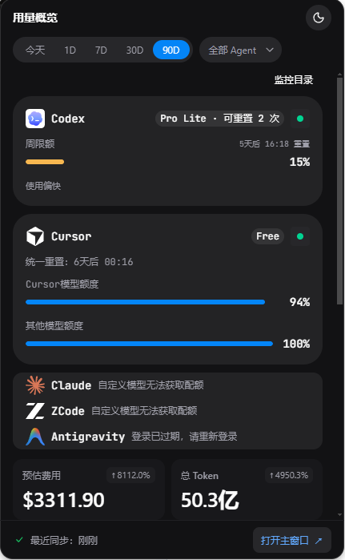
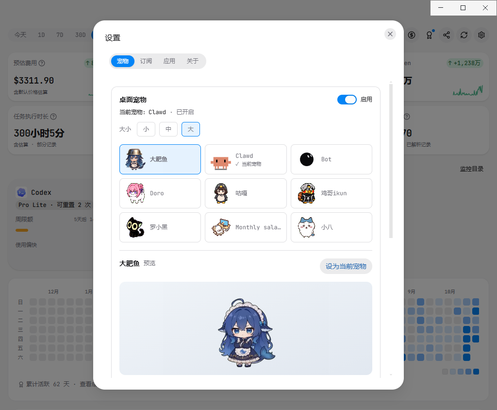
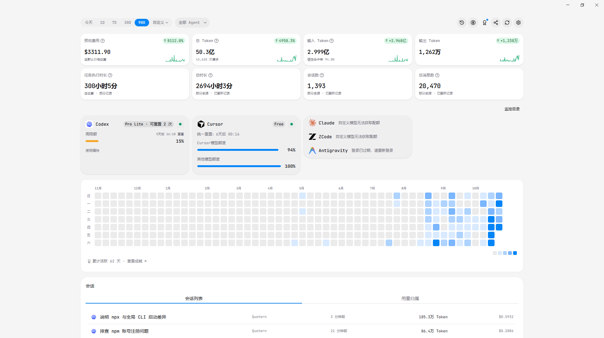

<h1 align="center">Quotern</h1>

<p align="center">
  <strong>English</strong> · <a href="./README.md">简体中文</a> · <a href="./README.ja.md">日本語</a> · <a href="./README.ko.md">한국어</a>
</p>

<p align="center">
  
</p>

<p align="center">
  <strong>All your AI usage, in one place.</strong><br>
  Track Coding Agent tokens, subscription quotas, estimated costs, and session history.
</p>

<p align="center">
  <a href="https://github.com/yuhengqin/Quotern">
    
  </a>
  <a href="https://github.com/yuhengqin/Quotern/issues">
    
  </a>
  <a href="https://github.com/yuhengqin/Quotern/releases">
    
  </a>
  <a href="https://github.com/yuhengqin/Quotern/releases/latest">
    
  </a>
  <a href="https://github.com/yuhengqin/Quotern/commits/main">
    
  </a>
</p>

<p align="center">
  <a href="https://github.com/yuhengqin/Quotern/releases">Download</a>
  ·
  <a href="#quick-start">Quick start</a>
  ·
  <a href="#feature-preview">Feature preview</a>
  ·
  <a href="./FAQ.md">FAQ</a>
  ·
  <a href="#agent-integration">Agent integration</a>
  ·
  <a href="#local-data">Local data</a>
</p>

Bring together usage from Claude Code, Codex, Cursor, Gemini CLI, and other AI coding tools. View trends and model and project breakdowns in a single dashboard. Desktop apps are available for macOS / Windows; the CLI provides a local browser dashboard on macOS / Windows / Linux.

<p align="center">
  
</p>

<a id="quick-start"></a>

## ⚡ Quick start

### 🖥️ Desktop app

Quotern provides desktop apps for macOS / Windows, ready to use after installation with no extra configuration.

#### Download and install

Visit [Releases](https://github.com/yuhengqin/Quotern/releases) and choose the package for your system and architecture:

| System / chip | Installer | Other downloads |
| --- | --- | --- |
| macOS Apple Silicon | `Quotern-<version>-mac-arm64.dmg` | `.zip` with the same base name |
| macOS Intel | `Quotern-<version>-mac-x64.dmg` | `.zip` with the same base name |
| Windows x64 | `Quotern-<version>-win-x64-setup.exe` | `*-win-x64-portable.exe` portable app |
| Windows ARM64 | `Quotern-<version>-win-arm64-setup.exe` | `*-win-arm64-portable.exe` portable app |

These names follow the new release workflow; attachments for older versions may use different names. macOS builds currently use ad-hoc signing by default and skip Apple notarization. The app links to the download page; updates require downloading the new version and replacing the app manually. Gatekeeper may block the first launch. After confirming the download comes from this project and checking the release checksums, follow [Apple's instructions](https://support.apple.com/en-us/102445) to find “Open Anyway” under System Settings → Privacy & Security. Developer ID signing and notarization remain available; consult the release notes and verification report for the build mode used.

The **Source code** downloads on a release are source snapshots of that tag. See [building from a source archive](./CONTRIBUTING.md#从-source-code-归档构建) for build instructions.

#### First launch

1. Open **Quotern**.
2. On its first run, the app attempts to register Claude / Codex hooks and sync local usage.
3. The dashboard opens automatically with usage trends, model breakdowns, and more.

If an Agent such as Claude or Codex is not detected, make sure it is installed and has been used at least once.

Usage data stays on your machine, and the dashboard reads the local statistics directly.

### ⌨️ CLI

Requires Node.js >= 20.10. On macOS / Windows / Linux, start it in the foreground with `npx`, without a global installation:

```bash
npx quotern
# Dashboard: http://127.0.0.1:8252
# Stop with Ctrl+C
```

For regular use, install globally and start the background service, which supports startup at login:

```bash
npm i -g quotern
quotern service start
# Dashboard: http://127.0.0.1:8252
```

If downloads are slow in mainland China, try `npm i -g quotern --registry=https://registry.npmmirror.com/`. See the [CLI guide](./CLI.md) for all commands, options, and data details.

Common commands:

```bash
quotern status           # Check runtime status
quotern sync             # Sync local usage manually
quotern doctor           # Check the environment and data sources
quotern usage --days 7   # Query usage for the last 7 days
```

On Windows, registering startup at login for the first time requires administrator privileges. The Linux background service requires a systemd user instance. You can run `quotern start` in the foreground instead; see [CLI quick start](./CLI.md#快速开始).

## ✨ Features

- **Unified usage across Agents**: Aggregate local logs or databases from coding tools and review consumption by Agent, model, and project.
- **Usage trends and activity heatmap**: Choose today, the last 24 hours, 7 / 30 / 90 days, or a custom range to explore input, output, cache, and cost trends.
- **Subscription quota monitoring**: View remaining quotas, usage windows, reset times, and reading status such as expired logins for supported providers.
- **Session history**: Search, filter, and sort collected sessions, then expand a session to inspect model usage, cache, cost provenance, and task duration.
- **Model pricing**: Look up model rates, estimate scenario costs, and compare models. The pricing catalog updates from [models.dev](https://models.dev).
- **Achievements and share cards**: Keep track of active days, usage streaks, and personal achievements. Create downloadable or copyable share cards for a selected period.
- **Compact desktop overview and pets**: Check key readings in a compact overview, and choose, preview, and resize desktop pets in Settings.
- **Direct Agent queries**: Ask about local statistics in natural language through the `quotern-usage` Skill, with JSON / CSV reports and an HTML usage overview.

Costs distinguish provider-reported amounts, model-rate estimates, and unknown prices. They must not be interpreted directly as actual payments. Coverage for sessions, messages, and task duration also varies by source; refer to the coverage notes shown in the interface.

<a id="feature-preview"></a>

## 🖼️ Feature preview

<table>
  <tr>
    <td width="50%" valign="top">
      <strong>Sessions and usage trends</strong><br>
      Review recent sessions and see how total tokens, input, cache, and output change over time.<br><br>
      
    </td>
    <td width="50%" valign="top">
      <strong>Agent, model, and project breakdowns</strong><br>
      Explore usage rankings and distributions to find which tools, models, and projects account for most consumption.<br><br>
      
    </td>
  </tr>
  <tr>
    <td colspan="2" valign="top">
      <strong>Session browser</strong><br>
      Filter by Agent and project, search sessions, and change the sort order. Expand a session to view models, input / output tokens, cache, and cost details.<br><br>
      
    </td>
  </tr>
  <tr>
    <td width="50%" valign="top">
      <strong>Achievement showcase</strong><br>
      Record your activity through badges, usage streaks, and goals unlocked over time.<br><br>
      
    </td>
    <td width="50%" valign="top">
      <strong>Usage share cards</strong><br>
      Choose a date range and Agent to create a share card with tokens, estimated costs, and model rankings.<br><br>
      
    </td>
  </tr>
  <tr>
    <td width="50%" valign="top">
      <strong>Compact usage overview</strong><br>
      Quickly check quotas, key usage figures, and the latest sync status in a small window.<br><br>
      
    </td>
    <td width="50%" valign="top">
      <strong>Desktop pets</strong><br>
      Choose a character, preview its appearance, adjust its size, and apply it as your current pet.<br><br>
      
    </td>
  </tr>
</table>

<details>
<summary>View the widescreen usage overview</summary>



</details>

## 🔌 Data sources and coverage

| Capability | Examples of supported sources | Notes |
| --- | --- | --- |
| Token and cost statistics | Claude Code, Codex, Cursor, Gemini CLI, OpenCode, GitHub Copilot, DeepSeek Harness, ZCode, and more | Based on logs, databases, or billing data provided by each tool; available fields and historical coverage vary by source |
| Subscription quotas | Codex, Claude, Cursor, Copilot, Grok, Kimi, ZCode, Antigravity, Qoder, MiniMax, OpenCode, DeepSeek | Requires a valid login or configuration for the provider; available quota windows depend on the account plan |
| Session and task statistics | Claude Code, Codex, Gemini CLI, OpenCode, Copilot, pi, OMP, DeepSeek Harness, Antigravity, ZCode, Kimi | Session and token coverage are calculated separately; missing or incomplete sources display coverage notes |

Additional usage sources include OpenClaw, AutoClaw, Hermes, Roo Code, Droid, Kiro, Cline, Amp, Qwen Code, CodeBuddy, WorkBuddy, Grok Build, Mimo, Every Code, Kilo CLI, Kilo Code, Goose, Zed, Warp, WPS Comate, Command Code, MiniMax Code, and KinetAios. See the [Core tool catalog](./packages/core/src/tool-catalog.ts) for the complete list.

Usage collection, subscription quotas, and session details each have their own coverage. For configuration and calculation rules, see [data collection and statistics](./docs/data-notes.md), [subscription data](./docs/subscription-plan-design.md), and [quota management](./docs/quota-management.md).

<a id="agent-integration"></a>

## Agent discovery and queries

Quotern includes the [quotern-usage Skill](./packages/cli/skills/quotern-usage/SKILL.md). Coding Agents that support Agent Skills can match usage questions to this Skill and query local data. Queries require an available Quotern CLI and synced local data. If you only have the desktop app installed, install the CLI as well.

### Recommended: install with npx skills

Install using the [Vercel Skills CLI](https://github.com/vercel-labs/skills). The installer currently requires Node.js >= 22.20; the Quotern CLI itself still supports Node.js >= 20.10.

```bash
npx skills add yuhengqin/Quotern --skill quotern-usage --full-depth --global
```

Follow the prompts to select your Agents. Link mode is recommended: the Skill is stored centrally at `~/.agents/skills/quotern-usage/`, and the installer creates links for Agents that need their own directories. Windows uses directory junctions; choose copy mode if links cannot be created. `--global` makes the Skill available across your projects. Omit it to install only for the current project.

You can also list discoverable Skills before installing:

```bash
npx skills add yuhengqin/Quotern --list --full-depth
```

To install from a local checkout, run `npx skills add ./packages/cli/skills/quotern-usage --global` at the repository root. If remote access fails, check your access to the GitHub repository or use an existing local checkout.

### Ask your Agent to install it

Send the following prompt to your Coding Agent so it can follow the [Agent installation guide](./README_AI.md), install the Skill, and report its verification results:

```text
Please read https://github.com/yuhengqin/Quotern/blob/main/README_AI.md,
install the quotern-usage Skill globally for the current Agent while preserving existing local customizations,
and verify file completeness, the Skill discovery path, and Quotern CLI availability.
```

### Manual copy (fallback)

If the installer is unavailable, copy the entire `quotern-usage` folder from the installed CLI npm package or this repository, including `references/`, `scripts/`, and `assets/`. The examples below use the current project's `.agents/skills/` directory; adjust it to your Agent's requirements. Installing the CLI globally does not automatically register the Skill with an Agent.

<details>
<summary>Show manual copy commands</summary>

macOS / Linux:

```bash
mkdir -p .agents/skills
cp -R "$(npm root -g)/quotern/skills/quotern-usage" .agents/skills/
```

Windows PowerShell:

```powershell
New-Item -ItemType Directory -Force .agents/skills | Out-Null
Copy-Item -Recurse (Join-Path (npm root -g) 'quotern/skills/quotern-usage') .agents/skills/
```

You can also copy the complete folder from [`packages/cli/skills/quotern-usage`](./packages/cli/skills/quotern-usage/) in this repository.

</details>

### Query through your Agent

Refresh Skills or start a new session as required by your Agent. Once `quotern-usage` is loaded, ask directly:

```text
Show my usage for the last 7 days.
How many tokens did Codex and Claude each use in the last 30 days?
Show usage and estimated costs for the Quotern project over the last 30 days.
```

The Skill selects the appropriate query. Broad usage requests produce a comprehensive HTML overview by default; specific questions receive concise answers. The Agent reads JSON through `quotern usage`, for example:

```bash
quotern usage overview --days 7 --json --compact
quotern usage models --source codex,claude --days 30 --json --compact
```

Queries only read local statistics already written to disk. They also work while Desktop is running and do not require starting an additional Web service. The Skill does not implicitly start services or sync logs. Freshness depends on the latest sync, and costs are either provider-reported amounts or rate-based estimates. See [usage reports and Agent queries](./CLI.md#用量报表与-agent-查询) for all parameters, data coverage, and cost semantics.

<a id="local-data"></a>

## Local data

Statistics are stored in `~/.quotern/` and include token counts, sources, models, and project attribution. Parsers read Agent logs or databases and save aggregated statistics buckets. Configuration also stores runtime information such as the local device identifier.

Some sources need access to Agent login state to retrieve billing data or subscription quotas. The pricing catalog and desktop updates also contact their respective services. The main process handles subscription credentials; the interface receives display snapshots. See [architecture notes](./docs/architecture-notes.md) for data flows and file purposes.

Usage is parsed, aggregated, and queried locally. The desktop app and CLI dashboard read the same set of local statistics. No Quotern account is required to get started; online readings such as provider quotas still require access to the corresponding services.

## 🛠️ Development notes

Repository development and testing require Node.js 22.13+. The pnpm version is pinned in the root `package.json`. Install dependencies at the repository root:

```bash
corepack pnpm install --frozen-lockfile --prefer-offline
```

Use `corepack pnpm dev:desktop` or `corepack pnpm dev:cli` for local development. Read the [worktree development rules](./docs/worktree-development.md) before starting. Use the dashboard address printed by the launcher.

<details>
<summary>Configure mirrors for slow Electron downloads</summary>

Electron binaries are downloaded from GitHub Releases by default, which may time out on networks in mainland China. Set mirror environment variables before installing:

```bash
# Git Bash / macOS / Linux
export ELECTRON_MIRROR=https://npmmirror.com/mirrors/electron/
export ELECTRON_BUILDER_BINARIES_MIRROR=https://npmmirror.com/mirrors/electron-builder-binaries/
corepack pnpm install --frozen-lockfile --prefer-offline
```

```powershell
# PowerShell
$env:ELECTRON_MIRROR="https://npmmirror.com/mirrors/electron/"
$env:ELECTRON_BUILDER_BINARIES_MIRROR="https://npmmirror.com/mirrors/electron-builder-binaries/"
corepack pnpm install --frozen-lockfile --prefer-offline
```

</details>

## 🤝 Contributing

The repository covers Desktop, CLI, and the browser dashboard. See the [Contributing Guide](./CONTRIBUTING.md) for branch conventions and local startup instructions.

- [Desktop](./CONTRIBUTING.md#desktop) — Electron desktop app
- [CLI](./CONTRIBUTING.md#cli) — Command line and local dashboard
- [Dashboard](./CONTRIBUTING.md#dashboard-开发) — CLI browser dashboard

Before making changes, read:

- [Architecture notes](./docs/architecture-notes.md)
- [Data collection and statistics notes](./docs/data-notes.md)
- [Runtime and maintenance notes](./docs/runtime-notes.md)
- [Development collaboration notes](./docs/development-notes.md)

Thanks to everyone who contributes! Submit a PR to join the contributors.

## 📚 References

- [dsh-pet](https://github.com/PC2005-cloud/dsh-pet): A desktop pet for DSH with over a hundred smoothly connected transparent animations, reacting to DSH session events with working-state animations.
- [Token Tracker](https://github.com/xiufengsun/TokenTracker): Multi-tool token usage tracking and dashboard. This README's feature presentation and screenshot layout draw on its [Chinese README](https://github.com/xiufengsun/TokenTracker/blob/main/README.zh-CN.md).
- [vibe-usage](https://github.com/vibe-cafe/vibe-usage): Token usage statistics CLI.
- [OpenUsage](https://github.com/robinebers/openusage): The Only AI Usage Tracker That's Truly Yours.
- [agent-usage](https://github.com/briqt/agent-usage): Collects local Agent session data and displays token usage, cost trends, and session details in a Web dashboard.
- [ccusage](https://github.com/ccusage/ccusage): Coding Agent usage analysis CLI.
- [models.dev](https://models.dev): Model token pricing data source used for incremental updates to the built-in pricing table.
