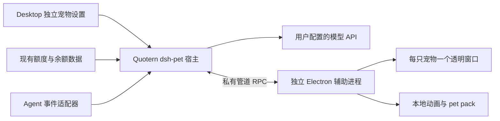

# dsh-pet 独立接入 Quotern Windows Desktop

日期：2026-10-19。状态：用户已确认本文，要求在独立 worktree 与新分支实现；正在准备实施计划。

## 目标与已确认范围

将 `reference/dsh-pet` 的桌面宠物作为独立子系统接入 Quotern Windows Desktop，保留其全部桌面交互与行为。用户明确要求不并入现有宠物系统，并选择先支持 Windows Desktop。

已确认的设计：独立设置入口、配置与辅助进程；完整动画与交互；聊天和碎碎念使用独立模型配置与记忆；余额/额度接入 Quotern 数据；六档工作状态增加真实事件适配，缺少事件时明确说明未接入；保留上游署名和素材限制。

本期不提供浏览器 Dashboard overlay，也不迁移或替换现有 Clawd/Bot/图集宠物。两个系统可以分别启停；dsh-pet 多实例的碰撞范围限本子系统。

## 当前源码事实

- 参考仓库：`reference/dsh-pet`，上游提交 `6c5f04321be050525b5cbb7bb8ee5f53e89deb6f`，内层包版本 `0.3.7`。
- 默认角色为“蓝毛小女仆”，默认实例 ID 为 `main`。内置配置引用 106 个唯一动作，磁盘均有对应文件。
- 106 段 WebM 共 54,351,332 字节，均为 640×360、VP9、24 FPS，含 alpha 标记。文档预览 GIF 不属于运行资源。
- 上游桌面端是 DOM/双 video 播放器与独立 Electron helper，不是可直接挂入 React 的单一组件。
- helper 在 Windows 关闭硬件加速，并使用独立的 DPI 参数与配置缓存。这些设置不能作用到 Quotern 主进程。
- Quotern 使用 Electron 35.4.0。采集同步通知只有 `active:boolean`/数据刷新语义；当前没有通用模型聊天客户端或完整实时 Agent 状态总线。

## 方案选择

采用“Quotern 托管的独立辅助进程 + 独立宿主适配层”。复用上游行为、播放器、物理和菜单，替换 DSH 的宿主依赖。

直接在 Quotern 主进程新建所有宠物窗口会把上游图形和 DPI 设置带到主应用；仅启动原版 standalone 则无法提供依赖 DSH 的聊天、工作状态等功能。将宠物改造成现有图集角色也不能满足用户对完整行为及独立性的要求。

## 模块与生命周期

建议文件边界：

- `apps/desktop/src/main/dsh-pet/`：配置/记忆、宿主请求处理、模型调用、事件适配、子进程管理。
- `apps/desktop/src/shared/dsh-pet.ts`：设置、状态、操作及事件契约；IPC 使用独立命名空间。
- `apps/desktop/src/renderer/components/DshPetSettingsCard.tsx`：独立设置入口和操作反馈。
- `apps/desktop/vendor/dsh-pet/`：固定版本的 shared、桌面 runtime、运行素材、默认配置、许可与来源清单。正式构建不得读取被 Git 忽略的 `reference/`。
- Desktop 构建入口、辅助模式引导及打包脚本：独立辅助进程入口与运行资源。

Quotern 默认不启用新宠物。用户启用后主进程启动辅助模式，使用随应用安装的 Electron 可执行文件，不安装 DSH、不另行下载 Electron。开发与正式打包分别处理资源路径。

辅助模式须在 Quotern 常规单实例锁、托盘、runtime 接管和窗口初始化之前分流；不得第二次启动采集、配额管理或自动更新。helper 的关闭硬件加速、DPI、userData/sessionData 设置仅影响 helper。若 Electron 35 的实际透明视频或跨屏行为不符合验收，不擅自升级全项目 Electron；先给出实机证据与局部可行方案。

由主进程经私有操作系统管道提供请求/响应与状态推送，Windows 使用随机命名管道和每次启动的能力令牌，带请求 ID、超时、关闭取消和消息大小限制。上游 helper 明确指出 Windows Electron 收不到重定向 stdin，原实现用 HTTP 回调应答；这里替换为双向命名管道，不依赖 stdin，也不沿用 HTTP 回调。renderer 继续通过本地自定义 scheme 读取配置、状态、视频和图片，保持上游消费形状；不新开无鉴权 HTTP 端口。资源请求支持视频所需的读取行为，路径限定在登记的内置素材和用户包目录。

关闭开关、退出应用、更新安装时均关闭所属窗口、取消模型请求、停止轮询并回收 helper。父进程消失、管道断开时 helper 自退；helper 崩溃有明确状态和手动重试入口，不无限重启。开发实例所有配置、模型设置、缓存和记忆都落入本 worktree 的隔离 userData；不写入 DSH 或正式 Quotern 目录。

## 行为保留与功能映射

| 能力 | 保留/适配要求 | 验收依据 |
| --- | --- | --- |
| 106 段动画与随机链 | 保留完整池、权重、分类、候选轮换和不连续重复规则 | 动作清单与实际文件对应，菜单可点播全部动作 |
| 播放衔接 | 保留双 video 缓冲、加载失败反馈、镜像/禁止镜像、统一脚底线 | 连续切换无空白、无反字、无明显位置跳变 |
| 点击 | 保留回应、Q 弹、积分、粒子与得分弹窗 | 连续点击和不同尺寸的反馈可见 |
| 拖拽与甩抛 | 保留弹簧跟手、温柔放下、速度采样、抛物线、反弹、摩擦及物理参数 | 慢放/快甩/触边与原版行为对照 |
| 漫游/固定模式 | 保留转向、真实行走、固定模式仅限制自主行为 | 固定模式下手动动作和拖拽仍有效 |
| 多实例 | 保留独立名称/尺寸/位置/开关、共享素材和可选跨窗碰撞 | 两只以上可独立操作，碰撞开关真实生效 |
| 多显示器 | 保留工作区边界、屏间空洞、异构 DPI、跨屏及锁定当前屏幕 | 真机拖过屏缝、飞行、热插拔/缩放变更 |
| 右键菜单 | 保留动作分类点播、碎碎念、聊天、查看额度、复位、重载配置 | 各项可执行，错误有可见反馈 |
| 打开宿主 | 原“打开 DSH/网站”映射为唤起 Quotern 主窗口 | 不触发 DSH 深链 |
| 透明窗口输入 | 保留身体命中区、穿透、拖拽捕获、菜单和聊天局部输入区域 | 透明余量可点下层应用；拖拽不丢 pointerup |
| pet pack/自定义素材 | 保留 JSONC 合并、目录覆盖、独立动画/表情包池、重载 | 新种类包与 main 自定义动作分别可播放 |
| 配置 | 保留全部上游配置能力，常用项表单 + 完整 JSONC 高级编辑 | 校验后原子保存，错误不破坏最后有效配置 |
| 字体和气泡 | 保留字体预设、字号/跟随尺寸、提示、文本与表情包 | 中文/长文本不裁切，字体失败有系统回退 |
| 无障碍 | 保留 reduced-motion、键盘可操作设置和可关闭功能 | 减少动效时不播 Q 弹/淡入，隐藏后不后台持续渲染 |

显示位置字段仍可读取 `web/desktop/both/none`；本期仅实例化含 desktop 的配置。全局关闭、暂停或隐藏属于功能控制，不删除实例和记忆。

## 设置与数据持久化

在 Windows Desktop 设置新增单独的 dsh-pet 卡片/面板，不加入现有宠物角色列表。主开关、实例管理、动作和物理设置、功能开关、字体、额度来源、模型配置及高级 JSONC 都归该入口。

独立根目录为 Electron userData 下的 `dsh-pet/`，其中存放主配置、pet pack、自定义动画/表情包、按实例隔离的聊天记忆及运行状态。与现有 `pets/` 目录、现有宠物偏好及 DSH 目录互不写入。初始位置和配置重载沿用上游语义，明确保存和复位行为。

配置读取与合并复用上游规则，包含全局默认、种类覆盖与实例字段；不得以一个简化子集取代完整配置。高级编辑返回字段定位错误，失败保留最后有效内容。主开关控制服务生命周期，不通过删除配置实现关闭。

## 聊天、碎碎念与记忆

新增专用模型服务。支持配置多个 OpenAI 兼容的 provider（名称、Base URL、模型和独立 API key），聊天与碎碎念可以分别选择；留空时使用用户明确选择的默认 provider/model。这里的默认指宠物模型设置，不读取“当前 Codex/Claude 会话模型”。保留上游候选链：首选模型失败时，若宠物默认模型与之不同则回落重试一次；相同选择去重，没有默认模型则直接反馈失败。取消和停用不触发回落。脱敏日志及操作结果显示实际采用的 provider/model 和发生过的回落，不记录 key 或聊天正文。

API key 留在主进程并使用系统安全存储加密；renderer 只收到是否已配置及脱敏标识。安全存储不可用时明确反馈，不静默以明文持久化。不得将现有订阅额度认证凭证当成聊天 key，也不得自动读取 DSH 凭证。

保留上游人设、按实例名称注入、碎碎念周期与手动触发、聊天记忆轮数、配图开关及表情包选择。未配置模型时功能显示“未配置模型”，其它桌宠能力可继续运行；自动模型调用只在主开关、实例碎碎念开关及模型配置均有效时发生，设置页明确标注会使用模型额度。

同一实例的聊天请求按序处理，碎碎念不覆盖正在进行的聊天。请求设超时和取消；停用/退出不继续写入过期响应。记忆按实例隔离、原子保存，并提供清除入口；网络失败、模型错误及截断保留原有可见反馈和通知条件。

## 余额与额度

直接消费 Quotern `QuotaState`/现有余额读数和刷新接口，不另读相同服务商凭证或复制一套采集。配置中选择一个明确的来源；多个额度窗口采用最紧迫的有效窗口，并显示窗口名、已用比例与重置时间。

有真实余额时显示余额；只有额度百分比时显示额度。记录的金额、估算成本和余额分别标注，禁止以 token 估算金额充当账户余额。陈旧、不可用、未登录等状态保留来源与原因；缺数据时沿用文字说明和去重，不伪造数值或播放满额动画。

余额动画档位及气泡时长、实例级开关、周期与手动查看均保留。刷新共享现有调度和去重，不因多只宠物重复请求。

## 工作状态与通知

保留六档状态机：`thinking/working/result/waiting/success/error`，以及每会话状态、优先级、终态清理、候选动画轮换、空闲解除循环和气泡时长。

新增独立的活动事件契约，至少包含来源、sessionId、turnId（可用时）、事件 ID、时间、明确状态与证据种类。重复事件去重，多会话不能相互覆盖任务文字；启动时不把历史记录重放成刚发生的任务。事件过期或来源断开后不能永久循环“工作中”。

工作状态有两类真实输入：

1. 宠物自身模型请求的开始、完成、失败与取消，由主进程直接发布。
2. 本地 Agent 来源的增量记录/可用 hook 事件，经来源适配器转换。先覆盖仓库现有 Codex、Claude、DSH 数据源中有明确证据的事件；各来源返回自己实际支持的状态清单及更新时间。

六档行为与测试必须完整，但不宣称每个 Agent 都能观测全部六档。现有统计 timing 和 Stop 信号不足以证明审批等待、压缩或任务成功；原始来源没有明确事件时标为未接入/未知，不用超时、采集同步完成或沉默推断成功/失败。不得为本功能静默改写用户的 Agent hooks；只读已有记录能覆盖的状态先接入，需要额外 hook 的状态在设置和文档中明确说明。新增事件适配器与统计计量/原有历史数据结构分离。

保留窗口失焦时的通知条件、完成/失败/截断/权限申请/用户选择类别与总开关；只对真实输入事件发通知。使用 Electron 通知接口，不要求 Dashboard 打开。额度已有通知与宠物通知按事件去重，避免双发。

## 素材、许可与构建

运行包包含完整 106 个 WebM、所需图片/表情包和默认配置；排除 GIF 文档预览、源视频和生成工具。素材复制由明确清单驱动，记录相对路径、大小、哈希及上游提交，确保构建不依赖 reference 目录。

保留原 MIT 版权及许可。上游 README 另规定素材允许开源使用、禁止商用，衍生作品的介绍/展示/分发需附 `https://github.com/PC2005-cloud/dsh-pet`。须在独立设置页、相关 README、第三方声明和打包资源中保留该来源与说明，不能将素材统称为 MIT。

参考仓库未提供所带“上首软糖体”的独立授权证明。本期保留字体预设与用户字体加载能力，内置默认使用系统字体，暂不分发该 TTF；用户自行提供对应字体时仍可选择使用。该资源问题不能被“代码 MIT”覆盖，不把未核实字体授权标成已确认。

增加 Desktop changeset 和 README 使用/验收说明；其它客户端不出现尚未支持的入口。

## 验证与交付标准

按风险限定测试：保留并运行复用的动作选择、物理、多屏、配置、状态聚合测试；新增宿主适配、事件语义、模型取消/记忆隔离、路径约束、私有桥接和父子进程退出测试。新模型服务用受控本地 mock，不使用真实付费 key。

必要构建检查：`corepack pnpm --filter quotern-desktop typecheck`、Desktop 测试、`corepack pnpm build:desktop`，再按涉及模块执行 Core 检查；最终产品验收按仓库要求执行 `corepack pnpm build` 和 `corepack pnpm test`，记录既有失败与环境限制。文档阶段仅检查文档和差异。

Windows 实机通过 `corepack pnpm dev:desktop` 隔离启动，核实透明播放、命中区/穿透、点击、慢放/快甩、反弹、多实例碰撞、菜单/聊天输入、106 动作可达、关闭/重启、更新/退出和 helper 崩溃处理。多屏、异构 DPI 和热插拔只有在实际具备设备并验证后才标为通过。

执行 `corepack pnpm build:desktop:win` 生成正式 Windows 包，并用打包产物核实辅助模式分流、可执行文件与资源路径、全部 106 段素材读取、菜单/聊天、关闭/退出和 helper 回收。未签名构建可用于本地验收，不发布安装包；无法完成正式包运行时，记录为尚未验收，不能以开发模式通过替代。

同时验收现有宠物仍可正常启停、选择/导入、显示统计与额度、拖拽贴边及恢复配置。新旧系统独立，互不接管配置或窗口。不能只以类型检查或打包成功宣称桌面行为已验证。

完成条件：上述行为清单逐项有实现与验证结论；依赖真实模型凭证、不可用 Agent 事件或缺少多屏设备的部分单独列明，不把占位界面、未接通状态或 mock 演示称为全部完成。

## 主要源码定位

- 上游行为和窗口：`reference/dsh-pet/dsh-pet/runtime/electron-helper/{main.js,preload.js,sprite.js,events.js,renderer.js}`。
- 上游契约与纯逻辑：`reference/dsh-pet/dsh-pet/src/shared/{types.ts,pickers.ts,physics.ts,displays.ts,work-status.ts}`。
- 上游配置/宿主：`reference/dsh-pet/dsh-pet/src/host/{config.ts,index.ts,work-status.ts}` 与 `assets/config.jsonc`。
- 许可：`reference/dsh-pet/README.md:566`、`reference/dsh-pet/LICENSE`。
- Quotern 生命周期：`apps/desktop/src/main/index.ts:494`、`:625`；quota：`apps/desktop/src/main/quota-runtime.ts:12`。
- 统计与活动边界：`apps/desktop/src/main/local-runtime.ts:624`、`packages/core/src/session-sources.ts:201`、`packages/core/src/task-timing.ts:4`。
